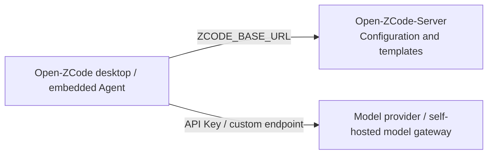
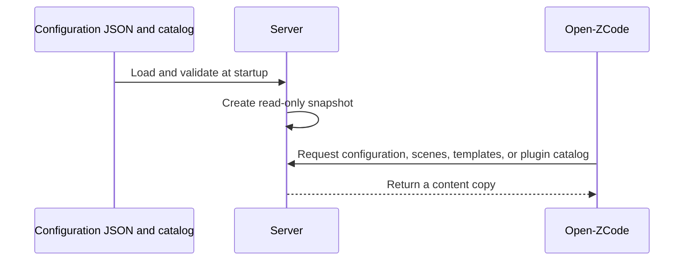

# Open-ZCode-Server

<p align="center">
  <a href="README.md">简体中文</a> | English
</p>

Open-ZCode-Server provides self-hosted client configuration and service APIs for [Open-ZCode](https://github.com/Leelion96/Open-ZCode), implemented independently against existing ZCode client contracts.

The client connects through `ZCODE_BASE_URL` while retaining its existing request and parsing logic, minimizing fork changes. Public configuration, provider templates, and automation templates are currently implemented and maintained in repository JSON files. Login, sharing, feedback, and update business capabilities are deferred.

## Main Features

- **Reduce client differences**: preserve the relevant paths, required fields, and response structures consumed by the current client, and handle configuration and service differences on the server where possible.
- **Own your configuration**: edit three JSON files for feature flags, scenes, and provider templates, version them in Git, and ship them with the image.
- **Deploy and run independently**: Docker Compose, an HTTPS example, and local API documentation are included. The service does not request or proxy official configuration services at runtime.
- **Clear capability boundaries**: implemented, placeholder, and unavailable APIs are distinguished with explicit responses; a registered route does not imply a working business capability.

The stack is **TypeScript + NestJS + Fastify + PostgreSQL + Prisma**, organized as a modular monolith. The current version is **0.1.0**, following the ZCode public API contracts, with this update accompanying client **3.16.2**; see the verification records for the tested scope.

## Relationship with Open-ZCode



Open-ZCode owns the application UI, workspaces, sessions, and Agent runtime; this project owns product service APIs. The client repository's `packages/server` provides Web / Agent runtime services and has different responsibilities. Model requests use the provider or gateway configured by the user; this project does not provide model inference or official account entitlements.

## Current Capabilities

| Capability                                                      | Current status                                                                                                            |
| --------------------------------------------------------------- | ------------------------------------------------------------------------------------------------------------------------- |
| `GET /api/v1/client/configs`                                    | Implemented: public feature configuration, with compatible version and platform parameters                                |
| `GET /api/v1/client/scenes`                                     | Implemented: draft suggestions and scheduled-task scenes                                                                  |
| `GET /assets/builtin-config.json`                               | Implemented: 15 API Key provider templates and model rules                                                                |
| `GET /api/v1/plugins/marketplace.json`                          | Implemented: metadata, categories, and download URLs for 33 non-paid official plugins                                     |
| 3 login, 6 sharing, 5 feedback, and 1 update APIs               | Placeholders: HTTP 501; business capabilities are not implemented                                                         |
| 14 model gateway, plan quota, MCP usage, and off-peak task APIs | Unavailable: routes are not registered, returning HTTP 404                                                                |
| PostgreSQL / Prisma                                             | Migrations, connection lifecycle, and readiness checks are provided; account and business data models are not implemented |

Counted by method and path, the 32 product APIs include 3 implemented routes, 15 placeholders, and 14 unavailable routes. Built-in configuration resources are counted separately. Placeholders do not generate tokens, publish shares, create tickets, upload files, or return installers.

See the [v1 specification](specs/v1.md) and [machine-readable API inventory](specs/api-inventory.json) for contracts. Integration scope and evidence are recorded in [Verification](docs/verification.md).

## Quick Deployment

Docker Engine and Compose v2 are required. Clone the project and deploy:

```sh
git clone https://github.com/Leelion96/Open-ZCode-Server.git
cd Open-ZCode-Server
cp .env.example .env
# Edit .env: replace the example passwords in POSTGRES_PASSWORD and DATABASE_URL consistently.
docker compose up -d --build --wait
```

Copy `.env` only for first-time deployment. Preserve existing configuration to keep the password consistent with the persistent database. In Compose, `DATABASE_URL` uses `db:5432`; URL-special characters in the password must be percent-encoded in the URL, while `POSTGRES_PASSWORD` uses the original password.

The default HTTP address is `http://127.0.0.1:3000`, bound only to host loopback. PostgreSQL does not expose a host port. The container runs `prisma migrate deploy` before starting HTTP; migration failure prevents startup.

```sh
curl http://127.0.0.1:3000/health/ready
curl 'http://127.0.0.1:3000/api/v1/client/configs?app_version=3.14.3&platform=darwin-arm64'
curl http://127.0.0.1:3000/api/v1/client/scenes
```

After startup, open the [local API documentation](http://127.0.0.1:3000/docs). The client needs the HTTPS deployment below to download built-in configuration.

After code or content changes, run `docker compose up -d --build --wait`. `docker compose down` preserves data. The database uses a persistent volume; do not use `down --volumes` in production. Do not commit `.env` or log credentials.

### HTTPS

For production, use an existing HTTPS reverse proxy and set `PUBLIC_ORIGIN` in `.env` to the public origin reachable by the client, such as `https://your-server.example.com`. Configure the domain, certificates, ports, and firewall for your deployment.

For local use, the optional Caddy profile defaults to `https://localhost:8443`, matching `PUBLIC_ORIGIN` in `.env.example`:

```sh
docker compose --profile tls up -d --build --wait
mkdir -p artifacts
docker compose cp tls:/data/caddy/pki/authorities/local/root.crt ./artifacts/local-root.crt
curl --cacert ./artifacts/local-root.crt https://localhost:8443/api/v1/client/scenes
```

Caddy uses an internal CA for this deployment. The client and its network runtimes must trust that CA; the service does not automatically modify the host trust store. The included Caddyfile is a local TLS example, bound to loopback by default, and does not automatically expose a public service.

## Connect Open-ZCode

| Location | Setting          | Purpose                                                                        |
| -------- | ---------------- | ------------------------------------------------------------------------------ |
| Client   | `ZCODE_BASE_URL` | Product service origin, without `/api/v1`                                      |
| Server   | `PUBLIC_ORIGIN`  | Public origin used to generate client-accessible resource URLs, without a path |

First confirm the Server's HTTPS address is reachable and its certificate is trusted by the client. Then start the desktop app from the Open-ZCode repository. On macOS / Linux:

```sh
ZCODE_BASE_URL=https://your-server.example.com pnpm dev:desktop
```

Windows PowerShell:

```powershell
$env:ZCODE_BASE_URL = "https://your-server.example.com"
pnpm dev:desktop
```

Replace the example URL with your deployment address; the local Caddy example can use `https://localhost:8443`. Process environment variables take precedence. Alternatively, maintain environment files as described in [Client Configuration](https://github.com/Leelion96/Open-ZCode/blob/main/README.en.md#configuration). Restart development or rebuild the distribution after changing build configuration. On first launch, skip login and configure your own model service.

`PUBLIC_ORIGIN` converts `/assets/builtin-config.json` into an absolute HTTPS download URL. If set to HTTP, the service omits this link to respect client constraints, so the client cannot update built-in provider configuration through that entry point.

`ZCODE_BASE_URL` controls the related product service APIs. The CDN, remote resources, third-party model URLs, and built-in client fallbacks have separate rules; deploying this service does not mean every client request uses a self-hosted address. Other clients may retain official help links, which must be checked in their respective forks.

## Customize Published Content

The three original configuration JSON files and the plugin catalog define public content. Edit them directly, version them in Git, and ship them with the image:

| File                                                   | Content                                                                                                              |
| ------------------------------------------------------ | -------------------------------------------------------------------------------------------------------------------- |
| [data/configs.json](data/configs.json)                 | Feature flags, feedback and community links, plugin ordering, and the built-in configuration download entry point    |
| [data/scenes.json](data/scenes.json)                   | Draft suggestions and scheduled-task templates, including localized prompts, plugin references, and scheduling rules |
| [data/builtin.json](data/builtin.json)                 | API Key provider templates and model rules; increment revision after changes                                         |
| [data/plugins/catalog.json](data/plugins/catalog.json) | Official catalog with paid-plan entries removed                                                                      |

The marketplace publishes 33 official marketplace entries whose `requiresPaidPlan` is not `true`. Browser Use and Node Repl Host remain client-provided. PluginMarketplaceService owns the catalog; clients fetch package archives and images from the official CDN. PublicContentService owns configuration, scenes, and provider templates.

Run `pnpm plugins:sync` to fetch the official marketplace JSON and remove paid-plan entries. `pnpm plugins:check` validates the resulting listing. Plugin metadata and package contents remain unchanged. See the [Plugin Marketplace Specification](specs/plugin-marketplace.md).

Current defaults disable CAPTCHA, forced updates, telemetry, off-peak tasks, Start Plan, and plan promotion. Personal and team plan catalogs are empty. General feature flags and plugin ordering are retained; feedback and community URLs are empty and can be set to your own entry points. A feature flag does not make a missing client runtime component available.

Scenes are limited to draft suggestions and scheduled tasks consumed by the current client. There are 15 API Key provider templates, with OpenAI and Anthropic first. Standard BigModel / Z.ai API templates are retained; official account Providers and Coding Plan API templates are removed. Third-party model provider URLs retain their original purpose.

The configs endpoint accepts and validates `app_version`, `platform`, and extension parameters. This version returns the same content for all versions and platforms. The service asynchronously loads and validates public configuration and catalog at startup and creates a read-only snapshot; responses return copies. Restart or rebuild after editing files. Missing files, invalid JSON, or failure of existing structure validation prevents startup.



Check and publish changes:

```sh
pnpm plugins:sync
pnpm plugins:check
pnpm content:check
# Docker deployment: rebuild the API, retaining database and TLS volumes.
docker compose up -d --build --wait app
```

For local development, restart the service. Run all commands from the project root. Configuration and the filtered catalog are read from `data/`. `pnpm plugins:sync` only fetches the upstream marketplace JSON; it does not download or modify plugin packages. See the [Public Content Specification](specs/public-content.md) and [Plugin Marketplace Specification](specs/plugin-marketplace.md).

## API Documentation

After startup, open [Swagger UI](http://127.0.0.1:3000/docs) to browse functional groups and statuses labeled `200 已实现 / 501 占位 / 404 不提供` (implemented / placeholder / unavailable). Click **Try it out** to edit parameters and **Execute** to inspect the real status, headers, and JSON response and copy a curl command. Raw documents are available at [openapi.json](http://127.0.0.1:3000/openapi.json) and [openapi.yaml](http://127.0.0.1:3000/openapi.yaml).

The 14 unavailable APIs appear only in documentation and are not registered. Placeholder POST examples probe failure responses and do not represent complete official request bodies. Sharing error code `3200` comes from a known client contract; generic placeholder `1501`, internal error `1500`, and readiness failure `1503` are defined by this project.

The page, JS/CSS, and documentation are served locally, with same-origin requests by default. `OPENAPI_ENABLED=false` disables `/docs`, documentation assets, and raw JSON / YAML. This entry point is for server debugging and is separate from client integration.

## Local Development and Verification

Node **24.18.0** and pnpm **10.33.2** are pinned in [mise.toml](mise.toml). The service name is fixed to `Open-ZCode-Server`; the software version comes from `package.json.version`, while database schema versions are managed independently through migrations.

```sh
mise install
pnpm install --frozen-lockfile
# Copy only for first-time setup when .env does not exist.
cp .env.example .env
# Set DATABASE_URL to your development database address.
pnpm db:migrate
pnpm dev
```

You can also run `pnpm build` followed by `pnpm start`. Development startup does not run migrations automatically. Public configuration APIs remain available when the database is temporarily unavailable: `/health/live` returns 200 and `/health/ready` returns 503. An unmigrated database also fails readiness.

```sh
pnpm verify
DATABASE_URL='development database URL' pnpm test:database
pnpm test:compose
```

`verify` runs type, lint, architecture, content, HTTP / content / negative architecture tests, and formatting checks. HTTP tests use real Fastify sockets and cover the API inventory, placeholder multipart requests, HEAD, CORS, invalid input, OpenAPI, and offline content. `test:database` requires a migrated real PostgreSQL database and checks reads, writes, rollback, and readiness.

`test:compose` uses a uniquely named verification project and temporary database to check image builds, migrations, health and APIs, real database tests, local CA HTTPS, and restart. It only removes containers and volumes created for that run and writes reports to ignored `artifacts/`. Executed results and client integration scope are recorded in [Verification](docs/verification.md).

Contributions follow [AGENTS.md](AGENTS.md) and [Architecture](docs/architecture.md): update specifications before implementing behavior, depend on public module interfaces, keep IO and Prisma out of controllers, and separate external contracts from database models.

## Future Work and Compatibility Boundaries

Extend capabilities as needed: independent accounts and login, share uploads/publication/previews, update manifests and installers, feedback tickets and attachments, and version or platform routing. Feedback attachments currently involve the client's OSS form-signing contract, which cannot be replaced directly with S3 credentials.

Compatibility is based on client source and anonymous public API samples. The official closed-source stack, internal data models, and complete rollout algorithms are unknown. This project does not guarantee compatibility with every historical or future client version or provide official plans and account entitlements. See [Verification](docs/verification.md) for specific versions and integration scope.

## License

Code is licensed under [Apache-2.0](LICENSE). This project is independently maintained. See [ZCode](https://github.com/zai-org/ZCode) for the upstream client source.

## Self-hosted plugin marketplace

GET `/api/v1/plugins/marketplace.json` returns the upstream catalog format, with only the 14 entries marked `requiresPaidPlan: true` removed. The remaining 33 entries retain their upstream fields, order, authors, versions, package URLs, and images. Clients fetch ZIPs and images directly from the official CDN. Browser Use and Node Repl Host remain client-provided.

Configure the client's existing `ZCODE_BASE_URL` with the product Server origin. Its default marketplace uses that origin and `/api/v1/plugins/marketplace.json`; configure the Server's `PUBLIC_ORIGIN` with the corresponding public HTTPS origin. Keep local addresses in development configuration rather than editing client source URLs.

Run `pnpm plugins:sync` to update `data/plugins/catalog.json`, then `pnpm plugins:check` to verify it. The Server does not download, save, repackage, or host plugin archives. See `docs/plugin-marketplace-verification.md` for current verification and constraints.
