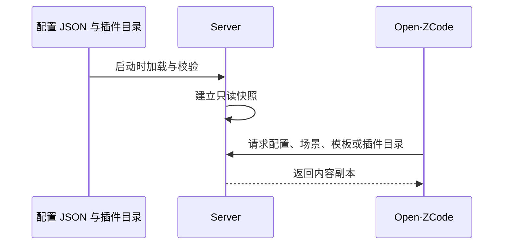

# Open-ZCode-Server

<p align="center">
  简体中文 | <a href="README.en.md">English</a>
</p>

本项目为 [Open-ZCode](https://github.com/Leelion96/Open-ZCode) （也可以接入到原始开源ZCode中）提供可自托管的客户端配置与服务 API，按 ZCode 客户端现有接口契约独立实现。

客户端通过 `ZCODE_BASE_URL` 接入自建服务，沿用已有请求与解析逻辑，做到尽量减少 fork 改动。当前已支持公共配置、供应商模板与自动化模板下发，内容由仓库中的 JSON 文件维护；登录、分享、反馈和更新业务留待后续实现。

技术栈为 **TypeScript + NestJS + Fastify + PostgreSQL + Prisma**，按功能模块组织单体服务。当前版本 **0.1.0**，沿用 ZCode 公共接口契约，本轮配套更新客户端 **3.16.2**；具体验证范围见下方记录。

## 当前能力

| 能力                                               | 当前状态                                                   |
| -------------------------------------------------- | ---------------------------------------------------------- |
| `GET /api/v1/client/configs`                       | 已实现：公共功能配置，兼容版本和平台参数                   |
| `GET /api/v1/client/scenes`                        | 已实现：草稿推荐、定时任务两个场景                         |
| `GET /assets/builtin-config.json`                  | 已实现：15 个 API Key 供应商模板及模型规则                 |
| `GET /api/v1/plugins/marketplace.json`             | 已实现：33 个非付费官方插件的元数据、分类及下载地址        |
| 登录 3 个、分享 6 个、反馈 5 个、更新 1 个 API     | 占位：HTTP 501，业务尚未实现                               |
| 模型网关、套餐额度、MCP 用量、闲时任务共 14 个 API | 当前不提供：未注册路由，HTTP 404                           |
| PostgreSQL / Prisma                                | 已提供迁移、连接生命周期和就绪检查；尚无账号或业务数据模型 |

按方法与路径计数，32 个产品 API 中有 3 个已实现、15 个占位、14 个不提供；内置配置资源另计。占位接口不会生成令牌、发布分享、创建工单、上传文件或返回安装包。

完整契约见 [首版规范](specs/v1.md) 和 [机器可读接口清单](specs/api-inventory.json)。联调范围与验证证据见 [验证记录](docs/verification.md)。

## 快速部署

需要 Docker Engine 和 Compose v2。首次获取项目并部署：

```sh
git clone https://github.com/Leelion96/Open-ZCode-Server.git
cd Open-ZCode-Server
cp .env.example .env
# 编辑 .env：替换 POSTGRES_PASSWORD 与 DATABASE_URL 中的示例密码，确保二者一致。
docker compose up -d --build --wait
```

复制 `.env` 仅用于首次部署；已有配置请保留，避免覆盖与持久化数据库对应的密码。Compose 中 `DATABASE_URL` 使用 `db:5432`；密码中的 URL 特殊字符需在 URL 中百分号编码，`POSTGRES_PASSWORD` 填原始密码。

默认 HTTP 地址为 `http://127.0.0.1:3000`，仅绑定宿主机回环地址；PostgreSQL 不暴露宿主机端口。容器先执行 `prisma migrate deploy`，迁移失败时不会启动 HTTP 服务。

```sh
curl http://127.0.0.1:3000/health/ready
curl 'http://127.0.0.1:3000/api/v1/client/configs?app_version=3.14.3&platform=darwin-arm64'
curl http://127.0.0.1:3000/api/v1/client/scenes
```

启动后可打开 [本地接口文档](http://127.0.0.1:3000/docs)。客户端使用内置配置下载时需要下方的 HTTPS 部署。

更新代码或内容后运行 `docker compose up -d --build --wait`。`docker compose down` 保留数据；数据库使用持久化 volume，不要在生产环境使用 `down --volumes`。不要提交 `.env` 或在日志中打印凭据。

### HTTPS

生产部署可接入已有 HTTPS 反向代理，将 `.env` 中的 `PUBLIC_ORIGIN` 设置为客户端能访问的公开 origin，例如 `https://your-server.example.com`。域名、证书、端口和防火墙按实际部署配置。

本地可使用可选 Caddy profile，默认地址为 `https://localhost:8443`，与 `.env.example` 中的 `PUBLIC_ORIGIN` 一致：

```sh
docker compose --profile tls up -d --build --wait
mkdir -p artifacts
docker compose cp tls:/data/caddy/pki/authorities/local/root.crt ./artifacts/local-root.crt
curl --cacert ./artifacts/local-root.crt https://localhost:8443/api/v1/client/scenes
```

Caddy 使用内部 CA，仅供本部署使用；客户端及其网络运行时需信任该 CA，服务不会自动修改宿主机信任库。提供的 Caddyfile 是本地 TLS 示例，默认绑定回环地址，不会自动发布公网服务。

## 连接 Open-ZCode

| 配置位置 | 配置项           | 作用                                       |
| -------- | ---------------- | ------------------------------------------ |
| 客户端   | `ZCODE_BASE_URL` | 产品服务 origin，不包含 `/api/v1`          |
| Server   | `PUBLIC_ORIGIN`  | 生成客户端可访问的公开资源地址，不包含路径 |

先确认 Server 的 HTTPS 地址可访问且证书受客户端信任，再在 Open-ZCode 仓库中启动桌面端。macOS / Linux：

```sh
ZCODE_BASE_URL=https://your-server.example.com pnpm dev:desktop
```

Windows PowerShell：

```powershell
$env:ZCODE_BASE_URL = "https://your-server.example.com"
pnpm dev:desktop
```

示例地址需替换为自己的部署地址，本地 Caddy 示例可使用 `https://localhost:8443`。进程环境变量优先；也可按 [客户端配置说明](https://github.com/Leelion96/Open-ZCode#配置) 维护环境文件。修改构建配置后重新启动开发或重新构建发行包，首次进入应用可跳过登录并配置自己的模型服务。

`PUBLIC_ORIGIN` 用于把 `/assets/builtin-config.json` 转为 HTTPS 绝对下载链接。设置为 HTTP 时，服务会省略该链接以遵守客户端约束，客户端不能通过该入口更新内置供应商配置。

`ZCODE_BASE_URL` 控制相关产品服务接口。CDN、远程资源、第三方模型地址和客户端内置回退有各自规则；部署本服务不等于所有客户端网络请求都已改为自有地址。其他客户端仍可能保留官方帮助入口，需在各自 fork 中核对。

## 定制下发内容

三份原有配置 JSON 与插件目录是公开内容的来源，直接编辑并纳入 Git，随镜像发布：

| 文件                                                   | 内容                                                         |
| ------------------------------------------------------ | ------------------------------------------------------------ |
| [data/configs.json](data/configs.json)                 | 功能开关、反馈与社群入口、插件排序及内置配置下载入口         |
| [data/scenes.json](data/scenes.json)                   | 草稿推荐、定时任务模板，包含本地化提示词、插件引用和调度规则 |
| [data/builtin.json](data/builtin.json)                 | API Key 供应商模板与模型规则；修改后必须递增 revision        |
| [data/plugins/catalog.json](data/plugins/catalog.json) | 上游官方目录过滤 `requiresPaidPlan=true` 后的公开列表        |

当前市场发布官方目录中 `requiresPaidPlan !== true` 的 33 个插件；Browser Use 与 Node Repl Host 仍由客户端提供。Server 托管市场列表 API；插件 ZIP 和图片 URL 保持官方地址，客户端直接从官方 CDN 下载。

运行 `pnpm plugins:sync` 拉取官方市场目录并过滤付费插件，`pnpm plugins:check` 检查结果。Server 不下载、保存或改写插件包，详细规则见 [插件市场规范](specs/plugin-marketplace.md)。

当前默认内容关闭验证码、强制更新、遥测、闲时任务、Start Plan 和套餐推广，个人与团队套餐目录为空。保留通用功能开关和插件排序，反馈与社群地址暂为空，可填写自己的入口。功能开关不代表客户端缺失的运行组件已经可用。

场景仅保留当前客户端消费的草稿推荐与定时任务。供应商模板保留 15 个 API Key 模板，OpenAI 与 Anthropic 排在前两位；普通 BigModel / Z.ai API 模板保留，官方账号 Provider 与 Coding Plan API 模板已移除。第三方模型供应商地址保留其原有用途。

configs 接口接受并校验 `app_version`、`platform` 及扩展参数；本版所有版本和平台返回相同内容。服务在启动时异步读取并校验原配置和插件目录，建立只读快照；每次响应返回副本，修改文件后需要重启或重建。缺文件、无效 JSON 或既有结构校验失败会阻止启动。



修改后的检查与发布：

```sh
pnpm plugins:sync
pnpm plugins:check
pnpm content:check
# Docker 部署：重建 API，保留数据库与 TLS volume。
docker compose up -d --build --wait app
```

本地开发则重启服务。所有命令从项目根目录执行；配置与目录读取 `data/`。`pnpm plugins:sync` 只下载官方目录 JSON，过滤 `requiresPaidPlan === true` 的插件后保存市场列表，不下载或修改插件包。详细规则见 [公开内容规范](specs/public-content.md) 和 [插件市场规范](specs/plugin-marketplace.md)。

## 接口文档

启动后打开 [Swagger UI](http://127.0.0.1:3000/docs)，按功能分组查看接口及 `200 已实现 / 501 占位 / 404 不提供` 状态。点击 **Try it out** 编辑参数，再点击 **Execute** 查看真实状态码、响应头和 JSON，并复制 curl 命令。原始文档位于 [openapi.json](http://127.0.0.1:3000/openapi.json) 和 [openapi.yaml](http://127.0.0.1:3000/openapi.yaml)。

14 个不提供的接口仅列于文档，不注册路由；占位 POST 示例用于探测失败响应，不代表官方完整请求体。分享错误码 `3200` 来自客户端已知契约；通用占位码 `1501`、内部错误 `1500`、就绪失败 `1503` 是本项目定义。

页面、JS/CSS 和文档均由本地服务提供，请求默认同源；`OPENAPI_ENABLED=false` 同时关闭 `/docs`、文档静态资源及原始 JSON / YAML。该入口用于服务端调试，独立于客户端接入。

## 本地开发与验证

Node **24.18.0**、pnpm **10.33.2** 固定于 [mise.toml](mise.toml)。服务名称固定为 `Open-ZCode-Server`，版本读取 `package.json.version`；数据库 schema 版本由迁移独立管理。

```sh
mise install
pnpm install --frozen-lockfile
# 仅首次配置且不存在 .env 时复制。
cp .env.example .env
# 将 DATABASE_URL 改为开发数据库地址。
pnpm db:migrate
pnpm dev
```

也可以 `pnpm build` 后运行 `pnpm start`。开发启动不自动迁移；数据库暂不可用时公开配置 API 仍工作，`/health/live` 返回 200，`/health/ready` 返回 503。数据库结构未迁移也无法通过就绪检查。

```sh
pnpm verify
DATABASE_URL='开发数据库 URL' pnpm test:database
pnpm test:compose
```

`verify` 执行类型、Lint、架构、内容、HTTP / 内容 / 架构负例测试与格式检查。HTTP 测试使用真实 Fastify socket，覆盖接口清单、占位 multipart、HEAD、CORS、错误输入、OpenAPI 与离线内容。`test:database` 需要已迁移的真实 PostgreSQL，验证读写、回滚和就绪检查。

`test:compose` 使用名称唯一的验证项目和临时数据库，覆盖镜像构建、迁移、健康与 API、真实数据库测试、本地 CA HTTPS 和重启；仅清理本次创建的容器及 volume，报告写入被忽略的 `artifacts/`。已执行结果及客户端联调范围见 [验证记录](docs/verification.md)。

贡献时遵循 [AGENTS.md](AGENTS.md) 和 [架构说明](docs/architecture.md)：先更新规范，再实现行为；功能模块通过公开入口依赖，Controller 不做 IO 或访问 Prisma，外部契约与数据库模型分开。

## 后续方向与兼容边界

后续按实际需求扩展：自有账号与登录、分享的上传发布和预览、更新 manifest 与安装包、反馈工单与附件，以及版本或平台分流。反馈附件当前涉及客户端的 OSS 表单签名契约，不能直接用 S3 凭据替换。

兼容依据是客户端源码和匿名公共接口样本。官方闭源实现的技术栈、内部数据模型与完整灰度算法未知；本项目不承诺兼容所有历史或未来客户端版本，也不提供官方套餐与账号权益。具体版本和联调范围以 [验证记录](docs/verification.md) 为准。

## 许可

代码采用 [Apache-2.0](LICENSE)。本项目独立维护，上游客户端源码见 [ZCode](https://github.com/zai-org/ZCode)。

## 自建插件市场

GET `/api/v1/plugins/marketplace.json` 返回上游原格式裸目录，只移除 `requiresPaidPlan === true` 的 14 个条目；其余 33 个条目的字段和顺序保持上游原样。插件包与图片仍使用官方 CDN URL，客户端直接下载；Browser Use 与 Node Repl Host 继续由客户端提供。

运行 `pnpm plugins:sync` 更新官方过滤后目录，`pnpm plugins:check` 验证条目来源和付费项过滤。

Docker 更新使用 `docker compose up -d --build --wait app`，保留既有数据库和 TLS volume。客户端通过现有 `ZCODE_BASE_URL` 配置 Server origin，默认市场自动使用其 `/api/v1/plugins/marketplace.json` 路径。插件 ZIP/图片由客户端访问官方 CDN；Server 不承载这些包。验收报告见 `docs/plugin-marketplace-verification.md`。

## 普通公告

兼容客户端横幅和弹窗，提供按设备幂等的确认/关闭回执。内容发布、资源及数据库迁移见 [普通公告文档](docs/announcements.md)。
