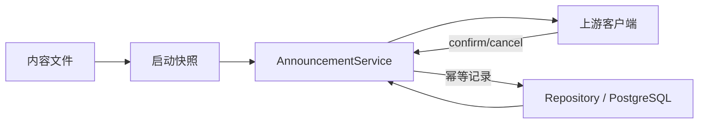

# 普通公告服务

兼容客户端 aac4755 的 Marketing Touch；保持客户端横幅、弹窗、资源和交互，不提供管理后台、账号或商业能力。

## 内容与接口

唯一来源为 data/announcements.json，结构为 schemaVersion:1、deliveries 下 zh-CN/en-US 两个数组。每项沿用 campaign_id、priority、resource_position 与 banner/popup；初始为空。启动异步校验并建立公共内容只读快照，修改后重启。相对资源 src 由 PUBLIC_ORIGIN 解析，本地资源在 data/announcement-assets 启动加载为有界缓冲，通过 /assets/announcements/ 提供，不在请求路径读文件。

GET /api/v1/marketing/touch 接受 X-Device-Mid UUID、X-Client-Language（zh-CN/en-US，省略为 en-US）与非负 seq，返回 {code:0,data:{server_time,language,deliveries}}。过滤设备已处理 ID，各位置取最高 priority，同优先级按原顺序，每个位置最多一条；不混用语言或回落官方。

POST /api/v1/marketing/touch/action 接受相同设备标识与 {campaign_id,action_type:confirm|cancel}，仅处理快照中存在的公告；成功 {code:0}。同 DeviceMid/campaignId 首次处理不被重试覆写，通过唯一 DatabaseService 持久化，跨重启保持。新 ID 才再次出现。设备 ID 是公告处理标识，不是账号或鉴权令牌。数据库失败明确失败，不伪装为空公告。

## 动作与所有者

允许 close、open_url、copy_text、普通 settings/plugin_marketplace 导航。拒绝 claim_zcode_plan、upgrade、rewards 与定位官方账号 Provider；违规内容启动失败，客户端共同动作入口再次校验。图片、视频、bundle 保留原结构与 SHA-256 校验；路径不得越界，内容与部署配置/凭据分离。

PublicContentService 持有内容及资源快照；AnnouncementService 决定选择和回执；Repository 通过 DatabaseService 持有处理记录；Controller 仅校验 DTO 并调用 Service。模块通过公开 index 和 Nest exports 连接，不导入客户端源码。

## 验证

独立 wire 样本、真实 Fastify HTTP、语言/优先级/空配置、资源 hash/路径/启动失败、商业动作拒绝、幂等回执、真实数据库迁移与重启持久化、新 ID、OpenAPI/接口清单及 Compose。原占位与排除接口状态不变，不清理原有用户数据。

本地资源响应地址包含 SHA-256 与文件名，以保证不可变缓存；源内容仍可填写相对资产路径。
