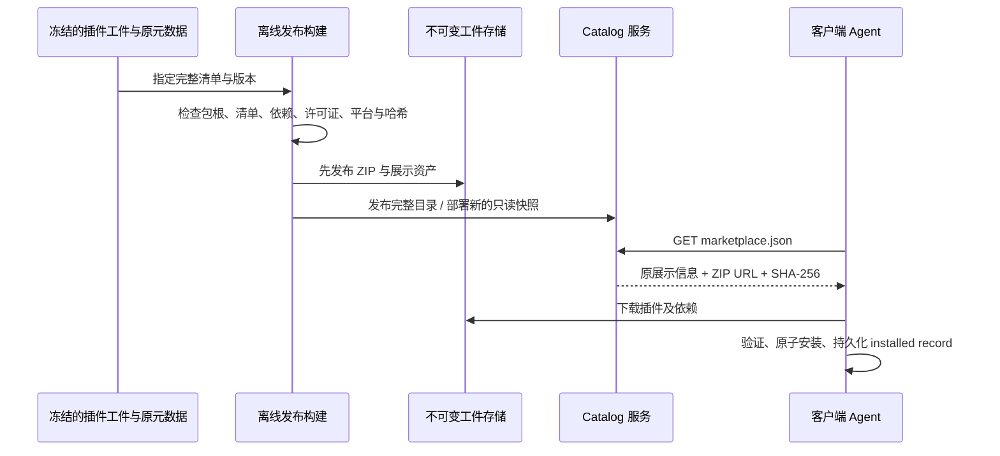

# 自建插件市场与客户端资源迁移设计

状态：已实现并完成本轮验收。2026-10-06。

本任务新建 Server 侧市场，客户端仓库中的可用插件只是一次性输入。服务端保存独立副本，运行和构建不导入客户端源码；原有 Browser Use 和 Node Repl Host 仍保留在客户端。

## 本轮实施规则

- 发布当前可用集合，排除两个原有基础插件。工件和展示信息来自输入快照，分组与原顺序保持。
- 技能及其 Markdown 引用正文清理品牌词：可删除的修饰词直接删除，需要主体时中文用“应用”、英文用 the app。展示作者与插件清单作者统一 Open-ZCode。
- 协议、环境变量、命令、路径和稳定 ID 属于运行标识，保持兼容并在审计中单列；许可证与版权声明保留真实原文。
- 原件与发布副本分开保留。修改签名材料时使用本发行者的新签名并验证，不关闭完整性检查；签名私钥不输出、不纳入代码库或镜像。
- 内容调整形成独立发行版本，记录 sourceVersion、来源和逐文件审计。功能代码及第三方服务配置沿用。
- 当前工件规模较小，首版启动时有界加载全部工件到只读内存，GET/HEAD 发送内存 Buffer，生产请求路径不读文件；总上限 128 MiB，超限拒绝启动。
- 新市场模块持有目录和工件事实；Agent 持有安装及运行事实。先构建并验证全部工件，再建立完整只读快照，最后接受请求。
- 验收真实 HTTP、客户端 ZIP 解析/安装与本地运行；不清空用户现有资料、不以空白完整应用身份代替正常实例。

## 目标与产品边界

1. 自建 Server 持有完整插件目录、ZIP 和展示资产；客户端通过市场 URL 浏览、安装和更新。
2. 插件清单、技能、命令、脚本、hooks、作者、许可、名称、分类、本地化描述、示例提示词和现有排序沿用已确认版本。
3. Browser Use 和 Node Repl Host 两个原有插件在客户端原样保留，其源码、载荷、打包、启用和运行绑定均不调整。其余插件的业务资源、源码快照与新增内置打包登记移到 Server；用户机器上的安装缓存、插件数据和配置继续由 Agent 管理。
4. Server 只提供分发与公开展示配置，不执行插件代码、不接管用户安装状态、不提供第三方 CLI 的业务接口或用户凭据。
5. 第一期使用现有部署和静态内容发布方式，不新增插件数据库、账号、上传入口或运营后台。

当前没有老用户，本期不设计历史来源、内置缓存、安装记录或用户配置迁移。首版采用“保留原有两个基础插件 + 其余插件使用现有市场安装链路”：客户端清理此次新增的本地插件资源后，只需修改默认市场 URL 即可浏览与安装服务端插件。先通过现有市场链路验收，再执行资源清理，不预设核心运行时改造。

Server 首版目录不发布 Browser Use 和 Node Repl Host 的远程替代条目，避免同名 CDN 条目覆盖客户端内置目录。客户端仍会把这两个本地插件与服务端目录合并展示。

## 当前源码确认的兼容条件

| 边界      | 当前事实                                                       | 设计要求                                                  |
| --------- | -------------------------------------------------------------- | --------------------------------------------------------- |
| 目录      | Agent 直接 JSON.parse 市场响应                                 | 成功响应为裸 marketplace JSON，不使用 code/data 信封      |
| 身份      | 插件 ID 为 name@marketplace；公开分段认 zcode-plugins-official | 第一版保留该市场技术 ID 和插件 name，作者信息独立保留     |
| ZIP       | source=url、type=zip、SHA-256、可选 path                       | 每个条目提供实际 ZIP 的哈希、HTTPS 绝对下载地址和正确包根 |
| 分类      | category 随目录；客户端处理显示名、分类归并                    | 保留原分类键，不按中文标签重命名                          |
| 精选      | 目录顶层 featured 是插件 name 的数组                           | 只沿用原名单；没有精选名单时不制造新精选                  |
| 排序      | code/work 的 categoryOrder、pluginOrder 来自 client/configs    | 保留既有 pluginStoreOrder，与目录共用完整插件 ID          |
| 图片      | UI 远端图片仅允许 HTTPS                                        | icon、heroImage 等采用 HTTPS 绝对地址                     |
| 地址      | 默认市场来源已有集中配置                                       | 只改默认 URL，不实现老用户来源迁移                        |
| 内置      | Browser Use 与 Node Repl Host 是原有基础插件                   | 两个原有插件原样保留；只清理新增插件资源                  |
| Node 宿主 | Browser Use 启用后由客户端绑定现有 node_repl                   | 保持当前装配，不从 Server 安装或替换这两个包              |

源码证据来自客户端的 plugin-marketplaces.ts、clientConfigService.ts、pluginStoreOrder.ts、adapters/plugins/marketplace.ts、zip-source.ts、built-in-node-repl.ts 和 startup-marks.ts。这里只记录契约，不从 Server 跨仓库导入这些实现。

## HTTP 契约

| 入口                                                     | 内容                              | 所有者                        |
| -------------------------------------------------------- | --------------------------------- | ----------------------------- |
| GET /api/v1/plugins/marketplace.json                     | 裸市场目录                        | 新增 PluginMarketplaceService |
| GET /assets/plugins/{name}/{version}/{sha256}/plugin.zip | 不可变 ZIP                        | 同域静态服务 / 反向代理       |
| GET /assets/plugins/{name}/{asset-hash}/{file}           | 图标、详情图片等不可变资产        | 同域静态服务 / 反向代理       |
| GET /api/v1/client/configs                               | 现有成功信封中的 pluginStoreOrder | 现有 PublicContentService     |

首版匿名只读，不增加下载登录。现有 ZIP 下载实现禁止 Authorization/Cookie 静态请求头；私有下载属于后续独立契约。

目录的核心结构：

```text
name: zcode-plugins-official
description: 原市场描述
featured: 原精选插件 name 列表（可选）
plugins[]:
  name、version、description、原始展示字段
  category、author、displayName、displayName_i18n、description_i18n
  icon、heroImage、homepage、privacyPolicy、termsOfService
  examplePrompts、examplePrompts_i18n、dependencies（如有）
  source:
    source: url
    type: zip
    url: PUBLIC_ORIGIN + 不可变 ZIP 路径
    sha256: 实际 ZIP 的 64 位十六进制摘要
    path: ZIP 中的插件根目录名
```

展示字段保留目录原来的扁平格式，不改成新的 listing 嵌套结构。清单内的命令、技能和 MCP 定义仍在包内 plugin.json，不移动到目录里重新实现。

目录使用 application/json 与 Cache-Control: no-cache。可以提供 ETag，但客户端当前没有条件请求优化，普通请求仍需得到可解析的 200 正文；不把 304 当作已实现的客户端更新机制。首次未就绪返回 503，缺文件返回 404，不返回 HTTP 200 的假空目录。

ZIP 和展示资产支持 GET/HEAD、Content-Length、正确 MIME 类型及长期 immutable 缓存。先验证公开端点 URL 可达，再写入目录；不可把对象存储内部地址下发给客户端。

## 分组、排序与地址的关系

- 分类键、本地化标题、作者、示例提示词属于目录条目，随市场 URL 获取。
- 精选由 featured 提供；已有公开/个人分段由市场 ID 决定。
- 分类排序与分类内插件排序仍使用现有 pluginStoreOrder，保留 code/work 两种模式及完整插件 ID。
- 本次在现有自建 Server 上增加市场，因此目录和 client/configs 使用同一部署 origin，不新增另一套排序管理入口。
- 客户端当前的排序请求按通用 endpoint 发送，不从市场 URL 推导 origin。仅更换为另一个域名的市场链接，并不会自动把排序来源一并切换。
- 若后续要求跨域市场切换也严格只改一个 URL，应在一次性客户端兼容改造中明确排序来源，可将排序作为目录的派生展示配置扩展；其编辑来源仍必须唯一，不能同时维护 catalog 与 configs 的两份排序。

## 内容与存储

建议采用如下结构，具体目录是拟新增内容：

```text
data/
  configs.json                       # 现有排序与公共配置
  scenes.json
  builtin.json
  plugins/catalog.json               # 原展示信息 + 发布工件相对引用
plugin-artifacts/
  {name}/{version}/{sha256}/plugin.zip
  assets/{name}/{asset-hash}/{file}
  releases/{release-id}/release.json  # 生成的审计、哈希与兼容性记录
```

catalog.json 是插件目录展示信息及发布引用的唯一内容来源；release.json 是构建生成的审计材料，不提供第二个手工编辑入口。绝对部署 URL 由 PUBLIC_ORIGIN 生成，与插件内容、账号凭据分离。

运行不读取客户端工作目录、不使用跨仓库 symlink、不依赖客户端 node_modules。发布输入来自已冻结的导出工件；待迁移插件从客户端项目删除以后，Server 仍能独立提供这些插件。两个保留的基础插件不计入服务端 ZIP 发布输入。

第一版插件目录和工件不进入 PostgreSQL。数据库暂不可用不应阻止已经加载的公开目录响应；现有数据库 readiness 语义保持。

## 模块与 IO 边界

拟src/plugin-marketplace 模块：

- contracts.ts：Zod schema，统一校验目录、DTO 与 OpenAPI。
- catalog-loader.ts：启动时有界异步读取目录、检查路径、版本与发布引用。
- plugin-marketplace.service.ts：持有唯一不可变目录快照，生成公开 URL，返回副本。
- plugin-marketplace.controller.ts：仅提供裸 JSON 响应，不操作 fs、数据库或插件进程。
- plugin-marketplace.module.ts、index.ts：提供公开模块和服务入口。

catalog 服务依赖 common；如读取排序，只通过 public-content 的公开接口获取既有快照，保持单向依赖。health 可通过公开接口检查目录是否就绪。AppModule 只组合模块。

当前 Server 明确禁止生产请求路径文件 IO，因此首版启动时同时校验并加载目录和全部工件，Nest 请求路径只返回已校验内存数据，Caddy 保持 HTTPS 反向代理。不要在 Controller 加 readFile/createReadStream 来绕过规则。如果未来要求 Nest 直接提供文件，需要先明确专属工件 IO 边界并更新架构约束，本版不默认采用。

生产 PUBLIC_ORIGIN 使用能被桌面及远程 Host 访问的 HTTPS 地址。localhost 仅用于同机开发；自签 CA 需要分别验证 Agent 和 Renderer 的信任。当前 UI 图片不能以 HTTP 回环地址替代 HTTPS。

实现前需要同步更新 architecture-policy.json、docs/architecture.md、API inventory/OpenAPI、Docker/Compose/Caddy 资源挂载，以及 AGENTS.md / public-content spec 中仅有三份内容 JSON 的既有范围描述。本轮已同步架构策略、内容约束、API 文档和 Docker 构建；Caddy 保持现有 HTTPS 反向代理，工件由受限内存快照提供。

## 发布流程与不变量



- 从可运行且已确认的版本导出，不从用户安装缓存打包；缓存可能含本机绝对命令、路径和用户选项。
- ZIP 采用统一 name/ 包根，目录 source.path 与其一致；包内 manifest name/version 与目录一致。
- 完整保留隐藏清单、MCP 文件、hooks、Node package.json、Python 代码、requirements、Mimosa payload 及所有许可证。不能使用先前内置资源白名单直接裁剪发布包。
- 不包含 .env、用户数据、会话、运行缓存、venv、Python 字节码、workspace 文件或主机绝对路径。Mimosa 的受保护 .mimosa 文件属于交付代码，不能误当运行缓存删除；签名载荷保持原字节。
- 若不改包内容，可复制原始 ZIP 并复用实际哈希；重新打包必须重新计算 ZIP 哈希，不用目录树哈希代替。
- 同一 name/version 不重复发布不同内容；代码或运行清单变化应升版本。构建输出需要稳定，不因 ZIP 时间戳导致同版反复出现不同摘要。
- 先发布工件，后发布目录；切换为完整快照，拒绝部分成功。保留旧版本，回滚切回旧目录；目录下架不主动删除用户已安装插件。
- 平台无关内容优先使用通用 ZIP。含原生模块的包必须具有明确平台覆盖；当前客户端不会自动传平台参数，不能靠 User-Agent 猜平台。需要分平台目录时，作为显式 URL/一次性客户端适配边界确认。
- 包内外部 CLI 与 Python 依赖要求保留，但不携带某台机器的绝对 Python 路径或虚拟环境。
- 依赖闭包以服务端插件集合验证；Browser Use 和 Node Repl Host 是本期明确保留的客户端能力。如原包引用它们，单独记录客户端提供约束并验证现有合并目录解析，不发布它们的远程替代载荷、不新增迁移规则。
- 许可证与来源完整保留。办公包原条款限制商业用途；迁移为 Server 分发不改变该条款，也不把它们重新许可为仓库 Apache-2.0。

## 客户端配合与资源清理

仅记录必要配合，执行属于后续客户端任务：

1. 先完成 Server 分发，用当前客户端验证 ZIP 目录显示、详情、安装、启停和更新，再清理新增本地资源。
2. 保留市场技术 ID 和插件 name，默认市场来源改为自建 URL；不实现旧默认 URL 替换、旧 seed/cache 转换或旧用户配置迁移。
3. 仅移除需要服务端分发的插件材料、对应新增 seed/SEA/desktop 载荷登记、展示清单和本地来源引用。Browser Use 与 Node Repl Host 的现有源码和资源、构建入口与运行绑定保持不动。
4. 普通插件通过现有安装/配置接口使用。Node、Python、npx、MCP 协议和本地依赖的兼容性纳入交付验收；不因服务端搬运预设客户端引擎重构。
5. Server 清单不包含客户端原有两个包的同名远程条目；已确认的插件内容仍按冻结版本发布，不为规避客户端排除规则改名。
6. workspaceIdentity、owner/lease、Host 路由和桌面/手机恢复语义沿用现有链路；下载和运行状态继续属于目标 Agent，Server 不接管。

本期客户端工作是 URL 配置与新增资源清理，没有历史用户兼容任务，也没有基础插件网络安装或装配迁移任务。

## 验收与执行顺序

1. 冻结交付清单；确认入口、版本、分类/排序、依赖、许可和平台兼容，不跟随另一会话的中间文件实时发布。
2. 发布构建校验：名称/版本唯一、ZIP 包根、manifest 对齐、SHA-256、全部必要文件、依赖闭包无缺项无环、无本机路径与用户文件。
3. Server HTTP：裸目录、完整字段、本地化/分类/精选保留、HTTPS 绝对 URL、目录和 ZIP/资产 GET/HEAD、404/503、MIME/缓存、客户端实际大小限制。
4. 更新/回滚：先有工件后有目录、同版不可变、失败不切半份目录、旧 ZIP 仍可下载、重新部署不丢历史版本。
5. 通过现有正常客户端验证浏览、详情、下载安装、更新、卸载/重装和离线已安装运行；不测试老用户迁移、不清空用户已有资料来制造场景。
6. 清理新增插件资源后，保留的 Browser Use / Node Repl 仍能正常调用；两者未被下载替代，服务端插件没有重复注册宿主。
7. 桌面、远程 Host 及手机 attachment；按实际发布包的平台范围检查，不能以一个 macOS 包宣称覆盖 Windows/Linux。
8. 实现阶段运行现有 Server typecheck、lint、test、architecture:check、format:check；涉及部署时运行 Compose 验证。本轮已执行实际接口、工件、安装器、Docker/Compose 和本地运行验证，证据见 docs/plugin-marketplace-verification.md。

## 尚需在实现前落定的输入

- 最终冻结的插件工件与其权威展示/排序来源。
- 正式 HTTPS origin 与历史工件存储/备份位置。
- 待迁移普通插件的运行依赖与平台兼容；两个客户端基础插件不需要新的发布输入或迁移设计。
- 其余插件按需下载安装；首启远程预装不属于当前“看到和安装”的范围。
- 发布使用范围与现有非商业/第三方条款匹配。

现有客户端 feature graph 未覆盖完整插件市场发布边界，后续客户端迁移任务应补充验证后的节点；本次不修改另一会话的客户端图或资源。
