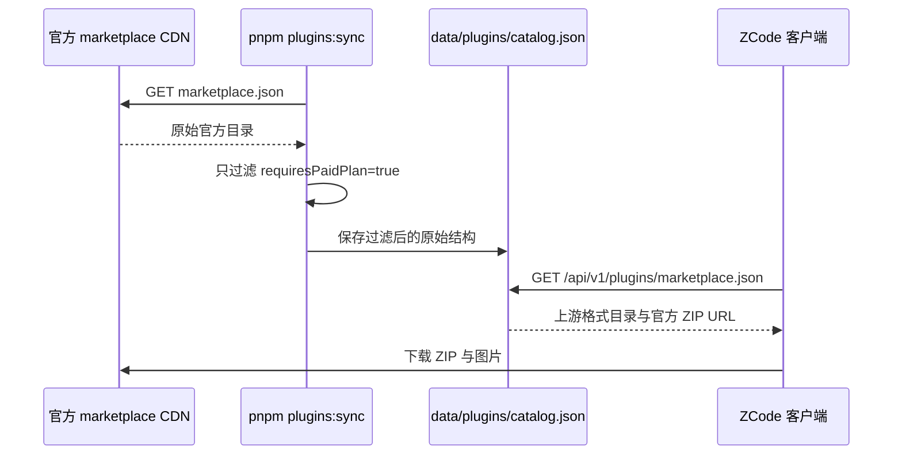

# 自建插件市场与客户端资源迁移设计

状态：2026-10-15 已按上游原样镜像并清理本地插件副本。

## v3.16.2 客户端合并配套（2026-10-21）

- 使用既有 `pnpm plugins:sync` 同步当前官方目录，只过滤 `requiresPaidPlan === true` 及对应精选引用；保留组件、发布者、版本、作者、来源、签名与其他元数据，不保存插件包。
- 同步前快照为 27 条；最终数量以本次下载的官方内容为准。只调整相关快照断言、当前能力说明与同步证据，不修改 API、数据库、模型目录 revision 35、工作流 `alwaysOn` 默认或客户端源码。
- 增加 `app_version=3.16.2` 的 HTTP 兼容样本，保持各版本/平台同一份配置的既有规则。市场验证涵盖新增条目、公开/社区和 UI 组件字段的原样透传。
- 官方 CDN 目录独立发布，不把本次新增插件全部归因于客户端的源码提交。沿用现有类型、Lint、测试、架构、内容与格式检查；本次不部署，Git 提交按用户明确授权在 `main` 执行，实际验证结果完成后记录。

Server 侧市场同步官方 ZCode marketplace JSON，只过滤付费计划条目。Server 返回官方目录格式，客户端仍从官方 CDN 下载插件包和图片。

## 本轮实施规则

- 同步输入为 `https://cdn-zcode.z.ai/zcode/official-plugin/marketplace.json`。只移除 `requiresPaidPlan === true` 的插件对象；字段缺省或为 false 的对象保留。完整替换 Server 市场目录，不与旧快照合并。
- Server 不下载、抽取、编辑、重打包或托管 ZIP；Marketplace 条目中的 URL、SHA-256 与图片地址全部沿用上游。
- 2026-10-21 同步的官方快照含 47 个条目，其中 14 个 `requiresPaidPlan === true`，目标目录为剩余 33 个。原有 Server 特有但官方市场缺少的 9 个条目不再发布。
- Server 返回的 marketplace 对象与官方 JSON 结构相同，仅 `plugins` 中移除付费项；若上游未来提供 `featured`，同步时也移除对应付费插件名。
- 不改写插件 Markdown、展示作者或 package/plugin manifest；沿用上游原文和元数据，避免制造与官方发布内容的差异。
- 协议、环境变量、命令、路径和稳定 ID 属于运行标识，保持兼容并在审计中单列；许可证与版权声明保留真实原文。
- `data/plugins/catalog.json` 是唯一公开目录源；`pnpm plugins:sync` 拉取上游 JSON、过滤付费项并覆盖该文件。构建不访问网络。
- 新市场模块只持有目录事实；Agent 和官方 CDN 分别持有插件安装/运行状态与插件包。
- 验收真实 HTTP 和当前客户端的市场解析；不清空用户现有资料、不以空白完整应用身份代替正常实例。

## 目标与产品边界

1. 自建 Server 持有过滤后的官方插件目录；客户端根据官方 source URL 下载包。
2. 除过滤 `requiresPaidPlan === true` 的 plugin object 外，清单字段和顺序沿用官方 JSON。
3. Browser Use 和 Node Repl Host 继续由客户端提供，不在 Server 目录中出现。
4. Server 不执行插件代码、不接管用户安装状态、不提供第三方 CLI 的业务接口或用户凭据。
5. 不新增插件数据库、账号、上传入口或运营后台。

客户端保留 Browser Use 和 Node Repl Host；官方目录不包含这两个条目。其余服务端市场条目通过现有市场安装链路分发。Server 仅同步目录，不更改客户端默认市场 URL 或客户端内置插件。

Server 首版目录不发布 Browser Use 和 Node Repl Host 的远程替代条目，避免同名 CDN 条目覆盖客户端内置目录。客户端仍会把这两个本地插件与服务端目录合并展示。

## 当前源码确认的兼容条件

| 边界      | 当前事实                                                       | 设计要求                                             |
| --------- | -------------------------------------------------------------- | ---------------------------------------------------- |
| 目录      | Agent 直接 JSON.parse 市场响应                                 | 成功响应为裸 marketplace JSON，不使用 code/data 信封 |
| 身份      | 插件 ID 为 name@marketplace；公开分段认 zcode-plugins-official | 保留官方 market name 与 plugin name                  |
| ZIP       | source=url、type=zip、SHA-256、可选 path                       | source 对象逐字段沿用官方目录                        |
| 分类      | category 随目录；客户端处理显示名、分类归并                    | 保留原分类键，不按中文标签重命名                     |
| 精选      | 官方目录可能包含 featured                                      | 过滤付费条目时同步过滤付费插件的精选项               |
| 排序      | code/work 的 categoryOrder、pluginOrder 来自 client/configs    | 保留既有 pluginStoreOrder，与目录共用完整插件 ID     |
| 图片      | UI 远端图片仅允许 HTTPS                                        | 保留官方 HTTPS 图片地址                              |
| 地址      | 默认市场来源已有集中配置                                       | 保持客户端默认 URL 和官方包 URL 不变                 |
| 内置      | Browser Use 与 Node Repl Host 是原有基础插件                   | 两个原有插件不加入 Server 目录                       |
| Node 宿主 | Browser Use 启用后由客户端绑定现有 node_repl                   | 保持当前装配，不从 Server 安装或替换这两个包         |

源码证据来自客户端的 plugin-marketplaces.ts、clientConfigService.ts、pluginStoreOrder.ts、adapters/plugins/marketplace.ts、zip-source.ts、built-in-node-repl.ts 和 startup-marks.ts。这里只记录契约，不从 Server 跨仓库导入这些实现。

## HTTP 契约

| 入口                                 | 内容                              | 所有者                    |
| ------------------------------------ | --------------------------------- | ------------------------- |
| GET /api/v1/plugins/marketplace.json | 裸市场目录                        | PluginMarketplaceService  |
| GET /api/v1/client/configs           | 现有成功信封中的 pluginStoreOrder | 现有 PublicContentService |

插件包由 ZCode 客户端根据 marketplace 条目中的官方 HTTPS URL 直接下载。Server 仅同步并提供过滤后的目录，不新增插件下载 API。

目录的核心结构：

```text
name: zcode-plugins-official
description: 原市场描述
featured: 原精选插件 name 列表（可选）
plugins[]:
  name、version、description、原始展示字段
  category、author、displayName、displayName_i18n、description_i18n
  icon、heroImage、homepage、privacyPolicy、termsOfService
  examplePrompts、examplePrompts_i18n、dependencies（如有）
  source: 上游原对象，source.url 保持官方 HTTPS 地址
```

`marketplace` 对象按官方结构原样保存，只过滤 `requiresPaidPlan === true` 的插件对象和对应 featured 项。展示字段保持扁平结构；author、version、source、分类、排序及其他字段不归一化。

目录使用 application/json 与 Cache-Control: no-cache。可以提供 ETag，但客户端当前没有条件请求优化，普通请求仍需得到可解析的 200 正文；不把 304 当作已实现的客户端更新机制。首次未就绪返回 503，缺文件返回 404，不返回 HTTP 200 的假空目录。

官方 ZIP、图标及详情图片继续使用官方目录中的 HTTPS URL；Server 不托管插件 ZIP 或图片，也不代理下载请求。

## 分组、排序与地址的关系

- 分类键、本地化标题、作者、示例提示词属于目录条目，随市场 URL 获取。
- 精选由 featured 提供；已有公开/个人分段由市场 ID 决定。
- 分类排序与分类内插件排序仍使用现有 pluginStoreOrder，保留 code/work 两种模式及完整插件 ID。
- 本次在现有自建 Server 上增加市场，因此目录和 client/configs 使用同一部署 origin，不新增另一套排序管理入口。
- 客户端当前的排序请求按通用 endpoint 发送，不从市场 URL 推导 origin。仅更换为另一个域名的市场链接，并不会自动把排序来源一并切换。
- 若后续要求跨域市场切换也严格只改一个 URL，应在一次性客户端兼容改造中明确排序来源，可将排序作为目录的派生展示配置扩展；其编辑来源仍必须唯一，不能同时维护 catalog 与 configs 的两份排序。

## 内容与存储

插件目录使用现有公共内容文件结构：

```text
data/
  configs.json                       # 现有排序与公共配置
  scenes.json
  builtin.json
  plugins/catalog.json               # 官方 marketplace JSON，过滤 requiresPaidPlan=true
```

`data/plugins/catalog.json` 是唯一内容来源。`pnpm plugins:sync` 从上游拉取 marketplace JSON，按规则过滤后直接更新该文件；构建和运行不访问网络。

第一版插件目录不进入 PostgreSQL。数据库暂不可用不应阻止已经加载的公开目录响应；现有数据库 readiness 语义保持。

## 模块与 IO 边界

拟src/plugin-marketplace 模块：

- contracts.ts：Zod schema，统一校验目录、DTO 与 OpenAPI。
- catalog-loader.ts：启动时读取并校验 marketplace 结构、付费过滤结果和官方 HTTPS 包来源。
- plugin-marketplace.service.ts：持有唯一不可变目录快照并返回副本。
- plugin-marketplace.controller.ts：仅提供裸 JSON 响应，不操作 fs、数据库或插件进程。
- plugin-marketplace.module.ts、index.ts：提供公开模块和服务入口。

catalog 服务依赖 common；如读取排序，只通过 public-content 的公开接口获取既有快照，保持单向依赖。health 可通过公开接口检查目录是否就绪。AppModule 只组合模块。

插件市场不需要静态工件服务。Caddy 只反向代理 API；插件 ZIP 和图片 URL 由客户端直接访问官方 HTTPS CDN。Server 运行时不执行任何插件代码。

## 发布流程与不变量



- 插件 source、ZIP、图片、作者、版本、签名和许可均沿用官方发布内容。
- 未标记付费计划的条目保留，包括该字段缺省的条目。
- 不从客户端缓存或本机安装状态生成插件目录。

## 客户端配合与资源清理

仅记录必要配合，执行属于后续客户端任务：

1. 使用当前客户端验证目录显示、详情和从官方 URL 安装。
2. 保留市场技术 ID 和插件 name，默认市场来源改为自建 URL；不实现旧默认 URL 替换、旧 seed/cache 转换或旧用户配置迁移。
3. 不修改客户端插件资源或默认 URL。Browser Use 与 Node Repl Host 的源码和资源、构建入口与运行绑定保持不动。
4. 普通插件继续通过现有官方 CDN 下载和安装流程使用；Server 不接管 Node、Python、npx、MCP 运行时。
5. Server 清单不包含客户端原有两个包的同名远程条目；已确认的插件内容仍按冻结版本发布，不为规避客户端排除规则改名。
6. workspaceIdentity、owner/lease、Host 路由和桌面/手机恢复语义沿用现有链路；下载和运行状态继续属于目标 Agent，Server 不接管。

本期客户端工作是 URL 配置与新增资源清理，没有历史用户兼容任务，也没有基础插件网络安装或装配迁移任务。

## 验收与执行顺序

1. `pnpm plugins:sync` 下载官方 marketplace JSON，移除 `requiresPaidPlan === true` 的条目。
2. 确认 `data/plugins/catalog.json` 除付费条目外与上游字段和顺序一致，source URL 未变。
3. `pnpm plugins:check` 校验付费项过滤、唯一插件名和官方 HTTPS 来源。
4. 用当前客户端确认市场目录可解析，并验证官方 CDN 包 URL 保留。
5. 运行 Server typecheck、lint、architecture、content 和格式检查。

## 尚需在实现前落定的输入

- 官方 marketplace 更新节奏由维护者按需运行同步命令。
- 客户端需要能够访问官方 CDN 插件包 URL。

现有客户端 feature graph 未覆盖完整插件市场发布边界，后续客户端迁移任务应补充验证后的节点；本次不修改另一会话的客户端图或资源。
