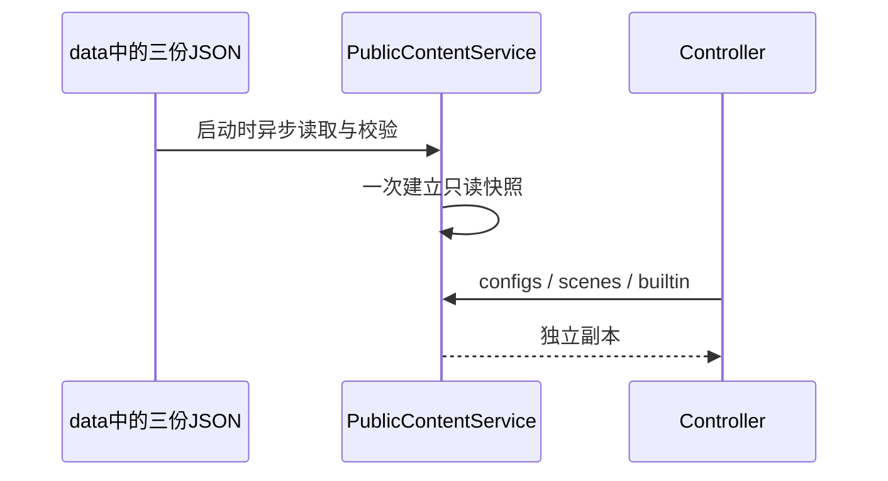

# 独立公共配置

## 数据与所有者

- 运行数据只有 `data/configs.json`、`data/scenes.json`、`data/builtin.json` 三份完整JSON，直接编辑并纳入Git与Docker镜像；没有官方样本与policy的合并、索引、运行时采集manifest或版本/平台分流。
- PublicContentService在启动时异步读取、进行既有结构校验并原子建立只读快照；HTTP返回副本。请求路径不读文件、不访问官方、不改数据库。
- `app_version`、`platform`继续接受与校验以兼容客户端，但不影响本版返回内容。configs/scenes保留成功信封，logid由common请求追踪生成，不要求配置JSON预置采集ID或占位字段。裸builtin release不增加信封字段。
- builtin下载地址在配置中使用本服务相对路径，启动时按PUBLIC_ORIGIN转换为HTTPS绝对地址；HTTP部署不下发下载链接。其他模型供应商地址不做改写。
- 缺文件、无效JSON或无效既有schema导致启动失败。保留已有敏感字段与不安全JSON键检查，不增加builtin规则深度验证或导入白名单。

## 默认内容

- 保留computerUse、desktopContextPrompt、dynamicWorkflow、pluginStoreOrder和本地builtin下载入口。插件与模板ID沿用客户端识别的名称，不按项目显示名重命名。
- 验证码、强制更新、遥测、闲时调度、Start Plan与套餐推广明确关闭；个人/团队套餐目录为空对象。移除促销文案与空magic_name。反馈与社群地址暂为空，待项目真实入口建立后填写。
- 仅下发当前客户端消费的2个场景：draft-suggestion（编程模式新任务草稿推荐）与scheduled-task（自动化定时任务模板）。移除没有消费入口的ai-slides、ai-writing、artifact、data-insight、file-tool、full-stack；不恢复off-peak-task。保留两个场景的完整提示词、选项ID、插件与cron默认引用；引用在所属场景内解析，不依赖已移除的场景。
- builtin保留15个API Key模板与通用模型规则；移除8个官方账号Provider及相应内置账号模型规则，清理指向zcode.z.ai的专用规则。删除bigmodel-api、zai-api两个Coding Plan API模板及引用它们的templateModelRules，保留bigmodel-standard-api、zai-standard-api普通API模板及对应规则。templateRules按openai、anthropic、其余模板原有相对顺序下发，不增加目录策略字段或接口。
- 首次自有修订为24。2026-10-05 客户端联调确认随包基线为30，正式内容曾发布为31；2026-10-06模板删减与排序发布为32，schemaVersion保持1。后续改变内容时递增，客户端拒绝同修订号的不同内容。本次针对尚未上线的新应用，不提供旧模板依赖迁移、不修改客户端缓存与源码；客户端固定分组和Plan导航不属于本次服务端变更。

## 内容维护

直接编辑三份正式JSON、运行`pnpm content:check`、重启或重建服务；不提供官方数据采集或自动导入命令。

## 验收

1. 正式data只有三份JSON，直接编辑后的内容通过校验并随服务发布。
2. 无版本、现有版本与未知平台返回同一份配置，query类型校验保持。
3. 实际HTTP验证通用开关、空套餐、关闭能力、仅含draft-suggestion与scheduled-task的2场景、模板/模型规则、本地HTTPS链接与请求logid；场景提示词、插件默认引用和cron默认引用完整且在同场景内解析；官方运营URL不进入运行数据。
4. 数据副本修改生效、错误JSON拒绝启动、响应副本隔离、离线启动；不写正常配置制造故障。
5. 类型、Lint、架构、格式、全部服务端测试和真实PostgreSQL/Compose检查；镜像只含正式数据，本机服务更新后数据库身份与既有数据保持。
6. builtin实际HTTP返回revision 32、15个模板，前两项为openai、anthropic；两个Coding Plan API模板及关联规则不存在，普通BigModel/Z.AI API模板与规则完整保留，其余模型规则、configs和scenes不变。重建正常部署的app容器后核对响应，保留既有db、tls容器和volume。

## 首轮客户端验收补充（2026-10-05）

当前客户端仅消费 draft-suggestion 与 scheduled-task；其余6场景的数据、提示词、选项与级联可验证，但当前没有界面入口，按用户确认留待下一轮。draft-suggestion 中不能保留 NAVIGATE:AUTOMATIONS:OFFPEAK 的残留推荐，否则关闭闲时开关后首页仍展示闲时任务入口。移除该推荐；不恢复已移除的 off-peak-task 场景。

## 场景收敛（2026-10-06）

复核当前客户端的接口、服务注册、远程RPC、资源缓存和UI消费链后，确认上述6场景没有消费路径；用户确认从正式配置移除。本节取代首轮补充中“留待下一轮”的计划。GET /api/v1/client/scenes的路径、成功信封与通用schema保持，data只包含上述2场景；不增加版本分流或第二份运行配置。办公模式主动推荐来自客户端自身目录，不由本接口维护。服务重启后发布新快照，客户端下一次重新请求时读取新列表。删除范围仅适配当前客户端，不声称兼容未核验的旧版官方客户端。
