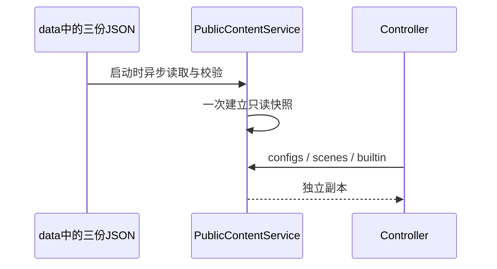

# 独立公共配置

## 数据与所有者

- 原公共配置由 `data/configs.json`、`data/scenes.json`、`data/builtin.json` 提供；插件市场由独立模块读取 `data/plugins/catalog.json`。`pnpm plugins:sync` 将官方 marketplace JSON 中 `requiresPaidPlan === true` 的条目移除后保存，其他字段与官方下载 URL 不改写；Server 不保存插件 ZIP 或图片。
- PublicContentService在启动时异步读取、进行既有结构校验并原子建立只读快照；HTTP返回副本。请求路径不读文件、不访问官方、不改数据库。
- `app_version`、`platform`继续接受与校验以兼容客户端，但不影响本版返回内容。configs/scenes保留成功信封，logid由common请求追踪生成，不要求配置JSON预置采集ID或占位字段。裸builtin release不增加信封字段。
- builtin下载地址在配置中使用本服务相对路径，启动时按PUBLIC_ORIGIN转换为HTTPS绝对地址；HTTP部署不下发下载链接。其他模型供应商地址不做改写。
- 缺文件、无效JSON或无效既有schema导致启动失败。保留已有敏感字段与不安全JSON键检查，不增加builtin规则深度验证或导入白名单。

## 默认内容

- 保留computerUse、desktopContextPrompt、dynamicWorkflow、pluginStoreOrder和本地builtin下载入口。插件与模板ID沿用客户端识别的名称，不按项目显示名重命名。
- 验证码、强制更新、遥测、闲时调度、Start Plan与套餐推广明确关闭；个人/团队套餐目录为空对象。移除促销文案与空magic_name。反馈与社群地址暂为空，待项目真实入口建立后填写。
- 仅下发当前客户端消费的2个场景：draft-suggestion（编程模式新任务草稿推荐）与scheduled-task（自动化定时任务模板）。移除没有消费入口的ai-slides、ai-writing、artifact、data-insight、file-tool、full-stack；不恢复off-peak-task。保留两个场景的完整提示词、选项ID、插件与cron默认引用；引用在所属场景内解析，不依赖已移除的场景。
- builtin保留16个API Key模板与通用模型规则；不发布官方账号Provider及相应内置账号模型规则，清理指向zcode.z.ai的专用规则。删除bigmodel-api、zai-api两个Coding Plan API模板及引用它们的templateModelRules，保留bigmodel-standard-api、zai-standard-api普通API模板及对应规则；沿用OpenCode Go的既有裁剪。templateRules按openai、anthropic、其余模板原有相对顺序下发，MiMo Token Plan紧随MiMo API，不增加目录策略字段或接口。
- 首次自有修订为24。2026-10-05 客户端联调确认随包基线为30，正式内容曾发布为31；2026-10-06模板删减与排序发布为32，供应商官方文档核验更新发布为33；2026-10-19与上游v3.16.1合并后发布35，避开当前客户端已使用但内容不同的34，schemaVersion保持1。后续改变内容时递增，客户端拒绝同修订号的不同内容。不修改客户端缓存与源码；客户端固定分组和Plan导航不属于本次服务端变更。

## 内容维护

直接编辑三份正式JSON、运行`pnpm content:check`、重启或重建服务；不提供官方数据采集或自动导入命令。

## 验收

1. 正式data包含原三份JSON和插件目录，直接编辑后的内容通过校验并随服务发布。
2. 无版本、现有版本与未知平台返回同一份配置，query类型校验保持。
3. 实际HTTP验证通用开关、空套餐、关闭能力、仅含draft-suggestion与scheduled-task的2场景、模板/模型规则、本地HTTPS链接与请求logid；场景提示词、插件默认引用和cron默认引用完整且在同场景内解析；官方运营URL不进入运行数据。
4. 数据副本修改生效、错误JSON拒绝启动、响应副本隔离、离线启动；不写正常配置制造故障。
5. 类型、Lint、架构、格式、全部服务端测试和真实PostgreSQL/Compose检查；镜像只含正式数据，本机服务更新后数据库身份与既有数据保持。
6. builtin实际HTTP返回revision 35、16个模板，前两项为openai、anthropic；两个Coding Plan API模板及关联规则不存在，普通BigModel/Z.AI API模板与规则完整保留。供应商更新范围见下节；configs和scenes不变。部署更新时保留既有db、tls容器和volume。

## 上游目录同步合并（2026-10-19）

- 输入固定为上游v3.16.1提交`0a1fc56d279fd1001f78387bd81aec1c26767411`的完整内置目录，以及本服务已核验的revision 33；上游和自有目录的revision不属于同一内容历史，不能因数字相同直接替换。合并结果发布为35，高于客户端随包34。
- 对共享模板保留自有模型ID、启用偏好、模型能力、显式限额与接口参数映射；保留GPT-6.1 Sol、GPT-6 Sol/Luna、Claude 5.5、FlashX、Qwen、MiMo Ultraspeed、Grok及聚合站点定制，不重新加入已确认失效或接口不匹配的模型。
- 吸收上游MiMo API展示名及独立的`xiaomi-mimo-token-plan`模板。Token Plan沿用上游API Key认证、`anthropic-messages`协议和专用地址，收录并启用`mimo-v2.6-pro`、`mimo-v2.6-flash`；普通API保留Ultraspeed与旧版本，两个模板不互相覆盖。
- 通用缺省上下文与最大输出采用上游最新的1000000和128000；保留自有未知模型默认不开放思考档位的规则。已配置的具体模型、API与站点覆盖继续生效，缺省限额不能覆盖GPT、Qwen Omni等明确限额。移除被新默认值完全覆盖的`[1m]`和ox-alpha/GLM预览重复限额规则，不批量改写现有正则或映射。
- 官方账号/套餐Provider、Coding Plan API和OpenCode Go的既有裁剪继续生效；不恢复已删条目，不新增模型代理、账号或数据库状态。唯一发布所有者仍是PublicContentService启动读取`data/builtin.json`，不引入运行时同步或跨仓库源码依赖。
- 验收16个模板、265个唯一模板模型条目与一一对应的规则；覆盖Token Plan协议和名称、未知模型默认值、GPT-6.1与Sol/Luna的思考差异、Qwen Omni与OpenRouter限额、既有裁剪、完整HTTP返回和客户端从随包34应用远端35。原有模型解析结果只允许在未设置显式限额时继承新的缺省上下文/输出；接口、思考映射及输入能力不得意外改变。

### 本轮验证

- 配置修改前，新增目录回归中4项失败，分别覆盖修订号、Token Plan、通用限额和模型规则引用；合并后6项目录回归全部通过。
- 服务端`pnpm verify`通过：类型、Lint、架构（52个生产源码文件）、内容、8文件/78项测试及全仓格式检查。目录JSON沿用原有对象与数组排版，没有无关格式化。
- 使用当前客户端真实Release解码、ModelConfigRules解析和参数映射编译器验证全部265个模型与713组合法思考档位；逐一对照原263项，19项只继承新的默认限额，所有原有输入能力、启用状态和请求映射保持一致。
- 启动本地Fastify HTTP服务，完整响应与正式JSON逐字段一致；客户端真实下载器通过测试请求适配器读取两条HTTP入口，验证随包34应用远端35返回updated、重复35返回unchanged。测试Active文件使用临时副本并在完成后清理，不修改用户配置或正常客户端缓存。
- 本轮不涉及数据库或部署变更；未执行数据库迁移、Compose发布、线上TLS验收或模型推理请求。

## 供应商目录核验（2026-10-06）

- 唯一正式数据仍为 `data/builtin.json`，由 PublicContentService 启动加载；核验记录位于 `docs/provider-template-audit-2026-10-06.md`，不增加运行时抓取、动态目录或第二份配置。
- 逐一核对全部15个模板对应供应商的官方模型目录、接口文档；聚合供应商另核对自己的模型ID和接口，不能直接照搬原厂ID。只新增现有文本/Agent接口能调用的模型，实时音视频、图像生成、专用决策接口与仅套餐可用的预览模型不加入这些模板。
- OpenAI、OpenRouter、OpenCode Responses补齐GPT-6 Sol、GPT-6 Luna、GPT-6.1 Sol；OpenAI/OpenRouter补齐GPT-5.5及Pro并清理官方目录中不存在的裸GPT-5.6别名。GPT-6.1 Sol/Astra不提供none/minimal；Sol/Luna支持none。原厂模板保持Responses，OpenRouter Messages分别映射effort与关闭思考，不向OpenAI请求注入Anthropic参数。
- Anthropic与已确认上架的聚合模板加入Opus 5.5、Sonnet 5.5，使用adaptive thinking与output_config.effort；1M上下文、128K输出。已宣布弃用但尚未到下线日期的旧模型保留，不把deprecated误判为已经不可调用。
- Z.AI、BigModel加入GLM-5.2、GLM-5.3-FlashX；FlashX继承Flash的视觉能力和不可关闭思考规则。MiniMax保留普通API现有M3/M2系列，M3.1-Flash-Preview仅套餐可用。Kimi与DeepSeek原厂最新模型ID已齐全；DeepSeek继续使用deepseek-flash动态别名。
- MiMo加入V2.6 Pro、Flash、Pro Ultraspeed及多模态/思考开关映射。Qwen中外模板加入已确认支持当前接口的3.8快照和开源版本；国际Omni按官方1M上下文、131072输出修正规则，不加入CN Messages不支持的Omni模型。
- xAI与支持其Responses的聚合模板加入Grok 4.7；推理档位包含medium。原厂文档未明确给出的数值不推测成最新上限；聚合站点公开的上下文、输出和输入能力通过templateModelRules覆盖，不能污染原厂规则。
- OpenRouter删除本次官方目录中缺失的ID及其templateModelRules；保留仍存在的旧条目及原有启用偏好。Zen的新模型按官方Endpoint表放入对应的三个既有模板，清理目录中缺失或接口不匹配的条目；未知预览模型保留通用能力默认值，不猜测上下文或推理档位。
- 发布33前验证模型ID/模板规则引用一致、无重复、正则可编译、GPT-6推理参数映射、FlashX视觉继承、网关能力覆盖、实际HTTP与当前客户端解析；运行类型、Lint、架构、格式与服务端测试。重建正常app容器后验证HTTP/HTTPS返回33与就绪状态，db/tls容器及卷身份保持。

## 首轮客户端验收补充（2026-10-05）

当前客户端仅消费 draft-suggestion 与 scheduled-task；其余6场景的数据、提示词、选项与级联可验证，但当前没有界面入口，按用户确认留待下一轮。draft-suggestion 中不能保留 NAVIGATE:AUTOMATIONS:OFFPEAK 的残留推荐，否则关闭闲时开关后首页仍展示闲时任务入口。移除该推荐；不恢复已移除的 off-peak-task 场景。

## 场景收敛（2026-10-06）

复核当前客户端的接口、服务注册、远程RPC、资源缓存和UI消费链后，确认上述6场景没有消费路径；用户确认从正式配置移除。本节取代首轮补充中“留待下一轮”的计划。GET /api/v1/client/scenes的路径、成功信封与通用schema保持，data只包含上述2场景；不增加版本分流或第二份运行配置。办公模式主动推荐来自客户端自身目录，不由本接口维护。服务重启后发布新快照，客户端下一次重新请求时读取新列表。删除范围仅适配当前客户端，不声称兼容未核验的旧版官方客户端。

## 普通公告扩展

data/announcements.json 是新增公开内容文件，公告和静态资源在启动形成快照，修改后重启；部署 origin 仍由 PUBLIC_ORIGIN 管理。协议和回执规则见 [公告规范](announcements.md)。
