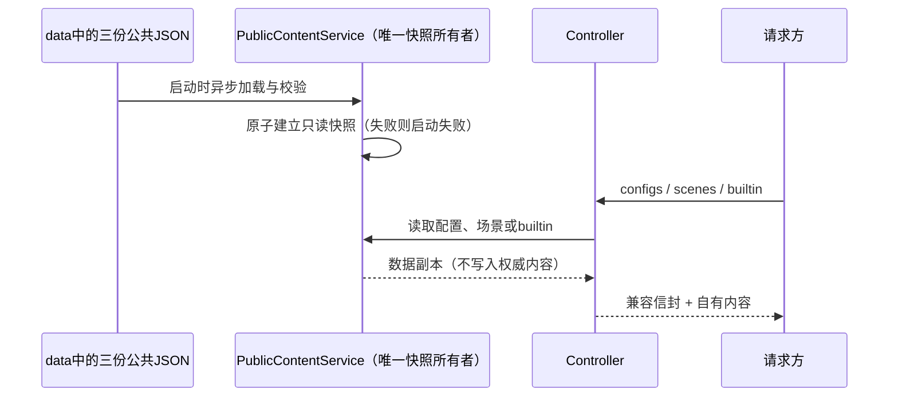

# Open-ZCode-Server 首版规范

状态：首版范围已实现，验证记录见 `docs/verification.md`。接口契约参考 ZCode checkout `29628c9acdb81b703bbd4080c207a0e7ce5e276e` 与公共接口样本；客户端联调和验收不在范围内。

## 范围

- TypeScript + NestJS + Fastify + PostgreSQL + Prisma，单体服务。
- 完整实现 `GET /api/v1/client/configs` 和 `GET /api/v1/client/scenes`。提供自有默认内容，结构兼容客户端。
- 登录的三个接口、分享的六个接口、反馈的五个接口、更新的一个接口存在并立即明确失败。登录流程、真实分享、附件上传、更新与工单业务均暂缓。
- 模型网关、套餐额度、MCP 用量和闲时任务共 14 个接口不注册，返回 404。产品网页不在首版范围。
- Docker Compose 提供服务和 PostgreSQL；服务端自身执行构建、类型检查、lint、契约和数据库/部署验证。验证由项目命令在本地执行，不依赖代码托管平台工作流。客户端联调和验收不在范围内。

## 所有者与边界

- 内容文件是公开配置与场景的唯一权威来源。启动时异步读取并校验成不可变快照；更新文件需要重启，不维护第二套可写数据库配置。
- 服务与内容检查统一读取固定data中的configs/scenes/builtin三份JSON；所有命令从项目根目录执行，不提供内容目录环境变量。
- 三份JSON直接表达完整下发内容，纳入Git与镜像；无policy合并、索引或运行manifest。PUBLIC_ORIGIN等部署参数独立管理；既有JSON安全与结构校验保持。细则见 `specs/public-content.md`。
- Controller 仅声明 HTTP 契约并调用 Service，禁止 IO 和数据库操作。
- Prisma 生命周期只由 Database 模块所有；未来各模块 Repository 通过该模块访问数据库，不把 Prisma 模型直接作为外部 DTO。
- Nest Module 的显式 import/export 是跨功能边界。功能模块之间不得导入对方内部实现；不引入 Express、循环依赖、客户端源码依赖或微服务。

## HTTP 规则

- 不假设所有官方接口共享信封。公共成功响应保留客户端信封结构。校验与 OpenAPI 从同一 Zod schema 定义产生；保留未知公开字段。
- configs对所有版本与平台统一返回自有默认配置；参数继续接受与校验，query允许扩展。
- 返回 `Cache-Control: no-store`，响应 JSON UTF-8。支持 GET/HEAD 和浏览器需要的显式 CORS 配置，默认不放开跨域。
- 占位接口统一 HTTP 501，JSON `{code: 非零, msg: 清晰说明, data: null}`。分享采用客户端已知的 3200；其他码标记为本项目定义。manifest 的成功格式为 YAML，但当前失败响应为非 2xx JSON，绝不伪造 manifest 或官方安装包。
- 任意 multipart 分享占位请求立即返回 501，不上传、不解析、不存储文件。超大正文由有界限制拒绝；错误不伪装为成功。
- request id 通过安全字符校验，响应和结构化日志关联；日志不包含鉴权头、请求正文、query 值或用户文件。
- 本地origin集中管理；builtin相对下载地址按PUBLIC_ORIGIN生成HTTPS地址，HTTP部署省略链接。模型供应商地址原样保留，不代理官方。客户端帮助链接与builtin内置回退仍在客户端范围外。

## 内容与能力

- data是我们维护的默认配置，保留通用功能开关、API Key模板、模型规则与当前客户端消费的2个场景（draft-suggestion、scheduled-task）；未消费的6个场景、官方账号Provider、套餐推广、闲时场景与运营资源链接已清理。
- 公共内容通过直接编辑三份JSON、执行`pnpm content:check`并重启或重建服务发布，不提供官方数据采集或自动导入命令。
- 除基础健康/就绪检查、OpenAPI与静态配置文件，不增加产品能力。可用功能、占位与缺失接口有机器可读清单。

## 数据库

- 首版不预建未确定的账号/权益模型。Prisma schema、迁移与 database readiness 构成扩展基础；允许仅建内部 schema 版本表并验证真实 PostgreSQL 读写，公开配置不依赖业务数据库状态。
- 进程启动校验所有环境值；数据库连通性通过 readiness 反映。连接由唯一服务持有，退出时释放；迁移作为独立部署步骤，不由请求路径执行。

## 验收证据

1. 首版 17 个接口存在：2 个成功、15 个 501；其余 14 个明确 404。
2. configs/scenes/builtin按自有默认行为与独立HTTP结构验证；参数兼容、数据副本隔离、缺文件、错误JSON与直接编辑生效均验证。
3. 离线启动和请求不访问官方。
4. 下载、普通请求、未知路由、错误请求、multipart 占位、请求 ID、HEAD/CORS 与 OpenAPI均进行 Fastify 实际 HTTP 测试。
5. Prisma 生成、迁移、真实数据库读写和就绪检查通过；Docker build 与 Compose health 通过。
6. 类型检查、lint、格式和架构自动检查通过；规则负例能被检查器发现。
7. 未实现能力与客户端接入限制在交付文档中列明。

## 构建配置

`pnpm build`使用`tsconfig.json`编译src，不保留单独的构建配置；`pnpm typecheck`通过`tsconfig.check.json`同时检查源码、测试与根目录TypeScript配置。合并配置后编译选项与文件范围保持一致。
